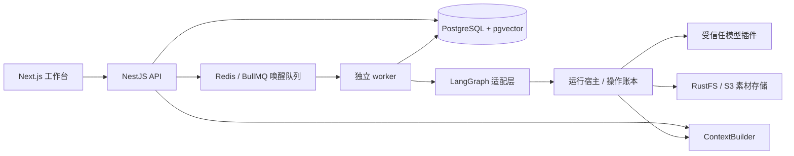

# 架构与关键决策

## 先建立领域，再适配框架

DramaFlow 的核心是用户保存的、版本化的工作流协议。React Flow 负责编辑，LangGraph 负责执行，LangChain 和供应商 SDK 负责模型传输。它们的内部对象都不是数据库中的业务协议。

依赖从应用指向领域包。`contracts` 不依赖框架；`context` 不读取数据库；`workflow` 不解密凭证；`plugins/manifest` 不加载供应商 SDK。API 与 worker 复用领域服务，但 HTTP 进程不会启动队列消费者。

## 模块化单体与独立 worker

采用同一代码库中的模块化单体，保持权限、发布、素材和运行边界清楚，避免首期引入跨服务事务。长任务由独立 worker 执行，API 不持有生成请求的生命周期。需要扩容时可以增加 worker 实例，而不是改写领域协议。

BullMQ 只发送“唤醒这个 run”的任务。它不逐节点调度，也不能替代 checkpoint。进程重启后的节点恢复由 LangGraph 与平台操作账本共同处理。

## 数据的四个层次

| 层次       | 内容                                       | 可变性                 |
| ---------- | ------------------------------------------ | ---------------------- |
| 工作流草稿 | 用户正在编辑的配置、执行连线、数据绑定     | revision 乐观锁        |
| 发布版本   | 已校验的完整定义、节点及插件版本引用       | 不可变                 |
| 运行与尝试 | 输入、状态、节点输出、审核、事件、操作记录 | 受控状态转换           |
| 素材版本   | 图片/视频/文件的元数据与存储引用           | 新生成或编辑创建新版本 |

运行中编辑画布只改变草稿。不能把旧 run 悄悄切换到新定义。重新生成创建新的运行分支，并保留来源和失效下游，避免覆盖历史。

## 团队与凭证

Better Auth 处理身份和 cookie 会话；工作空间成员决定业务权限。管理员管理成员、插件和凭证；编辑者编辑、发布、运行和审核；查看者只读。每次通过工作流、运行、会话或素材 ID 访问时，服务端重新解析其所属工作空间。

凭证通过服务端 AES-256-GCM 加密保存，主密钥来自环境。工作流只持有 connectionId；调用插件时宿主才解密。工作流导出、上下文、事件和浏览器响应不得包含明文密钥。

## 首期明确不做

公开 SaaS、商业计费、任意第三方代码上传、任意回边循环、嵌套用户图、跨会话长期记忆和素材 RAG 不在本次范围。未来向量检索使用现有 PostgreSQL pgvector，避免增加独立向量数据库。

## 对象存储

统一采用 RustFS，业务层依赖 S3 协议，不依赖厂商管理接口。资产版本在 PostgreSQL 中记录，二进制保存在 RustFS 私有桶；API 检查工作空间权限后读取内容。API 和 worker 使用同一桶，存储故障显式失败，不能静默写本地。历史 local 引用继续读取原目录，部署和迁移见 [对象存储](object-storage.md)。
